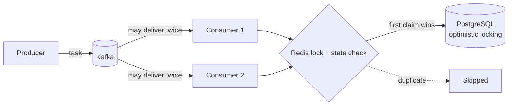
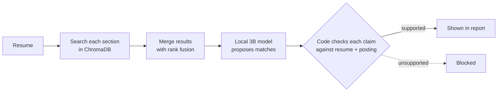

<p align="center">
  
</p>

<p align="center">      </p>

<p align="center">
  
</p>

<p align="center">
  <a href="https://pubudugunasekara.github.io/"></a>
  <a href="https://www.linkedin.com/in/pubudugunasekera/"></a>
  <a href="mailto:pubudupguna@gmail.com"></a>
</p>

##  Hi, I'm Pubudu

I build backends that stay correct when things go wrong, and AI systems that don't make things up.
Before grad school I was a QA engineer at Virtusa on a British Telecom platform with 1M+ users, so I test first and trust second.

>  **On my wishlist this year:** a **Summer 2027 SWE / AI internship** in the Bay Area. I've been good, and my tests are green.

##  Gifts under the tree

| Project | What it does | Proof |
|---|---|---|
| **[ResumeMatch](https://github.com/PubuduGunasekara/rag-resumematch)**<br><sub>Python · FastAPI · ChromaDB · Ollama · Next.js</sub> | RAG system that matches a resume against real job postings and checks every "match" claim in code before showing it | 107,528 postings in ~14 s on a laptop · recall@30 0.79 → 0.97 · 353 tests in CI |
| **[Distributed Task Scheduler](https://github.com/PubuduGunasekara/distributed-task-scheduler)**<br><sub>Java · Spring Boot · Kafka · Redis · PostgreSQL</sub> | Job scheduler that runs each task exactly once even when Kafka delivers a message twice | 0 duplicate runs in a 1,000-task load test · ~2,700 tasks/min · 188 tests, 93% coverage |
| **[AI Code Review Assistant](https://github.com/PubuduGunasekara/ai-code-reviewer)**<br><sub>React · Node.js · Redis · PostgreSQL · AWS</sub> | Sign in with GitHub, pick a pull request, get an AI review with severity-tagged findings · [live demo](https://main.d3dm91k4g9mtr9.amplifyapp.com/) | ~8 s per review · ~$0.002 per review |
| **[IoT Smart Farm](https://github.com/PubuduGunasekara/smart-farm-1.1.0)**<br><sub>React Native · Redux · Firebase · Arduino</sub> | Mobile app for real-time water, food, gate and cleaning control on a physical Arduino farm model (team lead) | Top 10 Most Innovative Projects, NSBM Green EXE |

<details>
<summary> <b>Unwrap this one: how the scheduler avoids running a job twice</b></summary>
<br>



Kafka delivers at least once, so duplicates are normal. A database state machine, optimistic locking and a Redis lock turn that into exactly one run per task.
</details>

<details>
<summary> <b>And this one: how ResumeMatch keeps the model honest</b></summary>
<br>



Early testing showed the model cited the wrong posting for 35 of 48 "matched" requirements, so now the model only proposes and code decides.
</details>

##  The workshop

<p align="center">
  
</p>

<p align="center"><sub>Also: JUnit · Testcontainers · Prometheus · ChromaDB · Ollama · OpenAI API</sub></p>

##  Off the keyboard

<table>
  <tr>
    <td align="center" width="33%"><br><b>Volleyball</b><br><sub>Find me on the court, any season</sub></td>
    <td align="center" width="33%"><br><b>Travelling</b><br><sub>Always planning the next trip, holidays included</sub></td>
    <td align="center" width="33%"><br><b>Potterhead</b><br><sub>Christmas at Hogwarts is the best chapter. Ask me my house.</sub></td>
  </tr>
</table>

<details>
<summary> <b>Dear Santa (click to open)</b></summary>
<br>

```yaml
name:        Pubudu Gunasekara   # "Pubzi" to friends
based_in:    San Jose, CA
studying:    MS Computer Science @ Northeastern (grad Dec 2027)
interests:   [backend systems, distributed systems, RAG and LLM evaluation]
house:       Backend
wand:        Java core, Python handle, Kafka finish
practicing:  NeetCode 150, one problem at a time
wishlist:    [Summer 2027 SWE internship, more volleyball, a Hogwarts letter (still waiting)]
```
</details>

<p align="center">   </p>

<p align="center">
   Happy holidays, and thanks for stopping by! Reach me at <a href="mailto:pubudupguna@gmail.com">pubudupguna@gmail.com</a>
</p>

<p align="center">
  
</p>
